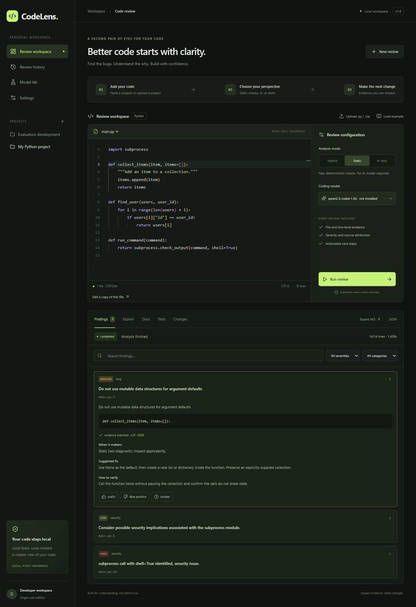

# CodeLens: Intelligent Code Review Platform

CodeLens is a full-stack automated code review and software quality audit platform built for our college capstone project. It combines deterministic static security analysis (Ruff, Bandit, and AST metrics) with local large language models (Qwen2.5-Coder, DeepSeek-Coder, and Code Llama via Ollama) to detect bugs, assess complexity, and suggest fixes in an interactive web workspace.

All source code remains private and local: no code is executed, and no external cloud services are required.



---

## Key Features

- **Evidence-Grounded Code Review:** Every reported bug or security issue is linked to exact file paths and source lines with verifiable code snippets.
- **Hybrid Static & AI Architecture:** Combines fast, deterministic linting (Ruff) and security scanning (Bandit) with local LLMs for deep semantic reviews.
- **AST Metrics & Code Health Score:** Calculates Cyclomatic Complexity, Cognitive Complexity, Halstead Software Science metrics, Maintainability Index, and a deterministic 0-100 Code Health Score.
- **Code Smell & Secret Detection:** Flags hardcoded credentials, API keys, god functions (>60 lines), deep nesting, and bare `except:` clauses directly from the AST.
- **Interactive Monaco Editor & Diff Viewer:** Inspect findings directly on the code, navigate files, and preview proposed code changes side-by-side.
- **Automated Artifacts:** Generates algorithm explanations with Big-O complexity, Google-style docstrings, pytest unit tests, and README drafts.
- **Model Comparison Lab:** Run the same code snapshot across Qwen Coder, DeepSeek Coder, and Code Llama sequentially to compare latency, findings, and coverage.
- **Multi-Format Export:** Export complete audit reports in HTML, Markdown, or JSON.
- **Offline Simulation Mode:** Includes an integrated offline provider to demonstrate the full review, diff, and test generation pipeline even without a GPU or active Ollama server.

---

## Tech Stack

| Layer | Technologies |
|---|---|
| **Frontend** | React 18, TypeScript, Vite, Tailwind CSS, Monaco Editor, Lucide Icons |
| **Backend** | Python 3.12, FastAPI, Pydantic v2, SQLAlchemy 2.0, Alembic |
| **Static Analyzers** | Ruff, Bandit, Python standard library `ast` |
| **AI Inference** | Ollama (Qwen2.5-Coder, DeepSeek-Coder, Code Llama) with structured JSON schemas |
| **Database** | SQLite (native mode) / PostgreSQL (Docker mode) |
| **Task Queue** | Python ThreadPoolExecutor (local) / Redis + RQ (production mode) |
| **Deployment** | Docker Compose / Native Windows PowerShell script |

---

## Quick Start on Windows

### Prerequisites
- Python 3.11 or 3.12
- Node.js 20+ and npm

From the project root folder:

```powershell
./start.ps1
```

The startup script will:
1. Create a local Python virtual environment in `backend/.venv`.
2. Install all backend dependencies.
3. Apply database migrations using Alembic.
4. Build and bundle the React frontend.
5. Start the FastAPI backend on `http://127.0.0.1:8000` and the frontend on `http://127.0.0.1:4173`.

Open your browser at **http://127.0.0.1:4173** to use the application.

---

## Manual Development Setup

### Terminal 1: Backend API

```powershell
# Navigate to backend directory
cd backend

# Create and activate virtual environment
python -m venv .venv
.venv\Scripts\activate

# Install dependencies
pip install -r requirements.txt

# Configure environment
Copy-Item .env.example .env

# Run database migrations
alembic upgrade head

# Start FastAPI server
uvicorn app.main:app --host 127.0.0.1 --port 8000 --reload
```

Backend API documentation is available at **http://127.0.0.1:8000/docs**.

### Terminal 2: Frontend Workspace

```powershell
# Navigate to frontend directory
cd frontend

# Install dependencies
npm install

# Start Vite development server
npm run dev
```

Open **http://127.0.0.1:5173** for live frontend development with hot-module replacement.

---

## Local AI Model Setup (Optional)

To enable live local AI reviews, install [Ollama](https://ollama.com/download) and pull any of the supported coding models:

```powershell
# Recommended lightweight model (1.5B parameters, runs on almost any CPU)
ollama pull qwen2.5-coder:1.5b

# Optional larger models
ollama pull deepseek-coder:1.3b
ollama pull codellama:7b
```

Once pulled, select **Hybrid** or **AI only** in the CodeLens interface and run a review.

> **Note:** If Ollama is not installed or offline, you can still run complete static reviews anytime, or enable offline simulation mode (`CODELENS_MOCK_AI=1` in `backend/.env`) for classroom presentations.

---

## Docker Compose Deployment

To run CodeLens with PostgreSQL, Redis, and an asynchronous RQ worker:

```bash
docker compose up --build
```

Access the application at **http://127.0.0.1:8080**.

---

## Testing

### Run Backend Unit Tests

```powershell
cd backend
.venv\Scripts\activate
pytest -v
```

All 36 unit and integration tests validate AST metrics, ingestion safety, path traversal rejection, finding deduplication, and API endpoints.

### Run Frontend Unit Tests

```powershell
cd frontend
npm test
npm run build
```

---

## Sample Code Included

Test the review pipeline with the sample files in the `samples/` directory:
- `samples/vulnerable_microservice.py`: Contains intentional SQL injection, command injection, and pickle vulnerabilities to test security detection.
- `samples/inefficient_algorithms.py`: Contains quadratic searches, naive recursion, and unclosed file handles.
- `samples/clean_production_code.py`: Reference code demonstrating 100% typing and docstrings.
- `samples/sample_project.zip`: Multi-file project testing safe ZIP extraction and package traversal.

---

## Documentation

- [Architecture & Database Design](docs/ARCHITECTURE.md)
- [College Project Report & Viva Guide](docs/COLLEGE_PROJECT.md)
